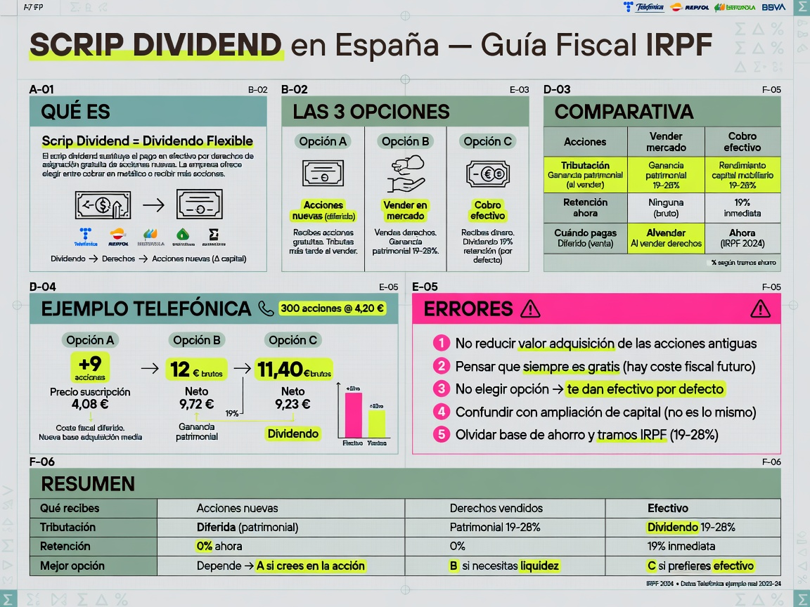

export const metadata = {
  title: "Scrip dividend en España: qué es, cómo funciona y fiscalidad en el IRPF — FinView",
  description: "Guía completa sobre el scrip dividend o dividendo flexible: qué es, las 3 opciones del accionista (acciones, vender derechos o cobrar en efectivo), tratamiento fiscal en el IRPF para cada caso, ejemplos con Telefónica y Repsol, y cómo afecta a tu cartera de dividendos.",
};

# Scrip dividend en España: la guía fiscal que tu broker no te explica

Recibes un email de Telefónica: "Tu dividendo flexible está disponible." Tres opciones en pantalla. No tienes claro qué elegir. Si aciertas, ahorras impuestos. Si no, pagas de más o te llevas un susto en la renta. Y nadie —literalmente nadie— te explica la diferencia.

Vamos a cambiar eso.

---

## 1. Qué es exactamente un scrip dividend

Scrip dividend —también llamado "dividendo flexible" o "dividendo elección"— es un mecanismo por el cual una empresa sustituye el pago tradicional de un dividendo en efectivo por la entrega de **derechos de asignación gratuita**. En vez de ingresarte dinero, te da unos vales que puedes convertir en tres cosas distintas.

No es dinero nuevo. Es la misma retribución al accionista, pero empaquetada de forma diferente. La empresa amplía capital con cargo a reservas y te entrega derechos proporcionales a las acciones que ya tienes.

Las grandes cotizadas españolas lo usan de forma habitual:

- **Telefónica**: lleva años ofreciendo scrip dividend en sus pagos complementarios.
- **Repsol**: ha combinado efectivo y scrip en sus últimas retribuciones.
- **Iberdrola, BBVA, CaixaBank, Naturgy, Enagás**: todos han usado esta fórmula en algún momento.

Si inviertes en el Ibex 35, tarde o temprano te encontrarás con uno. Y la decisión que tomes tiene consecuencias fiscales distintas en cada caso.

---

## 2. Las 3 opciones del accionista

Cuando una empresa lanza un scrip dividend, tú decides qué hacer con los derechos que recibes. Hay tres caminos posibles:

### Opción A — Convertir los derechos en acciones nuevas

Entregas tus derechos y recibes acciones adicionales de la empresa. No pagas nada: las acciones salen de una ampliación de capital liberada.

**Ejemplo**: Tienes 500 acciones de Telefónica. La empresa ofrece 1 derecho por cada acción. Ejercitas todos tus derechos y recibes, digamos, 15 acciones nuevas (según la ratio de conversión que fije la compañía).

### Opción B — Vender los derechos en el mercado secundario

En vez de convertirlos en acciones, vendes tus derechos en bolsa a otros inversores que sí quieren las acciones nuevas. Durante un periodo determinado (normalmente 2-4 semanas), los derechos cotizan como un valor independiente.

**Ejemplo**: Tienes 500 derechos. Cada derecho cotiza a 0,04 €. Los vendes todos y recibes 20 € en tu cuenta del broker.

### Opción C — Vender tus derechos a la empresa (retribución en efectivo)

Si no haces nada —ni ejercitas ni vendes en mercado—, la empresa compra tus derechos al precio fijado en la operación y te ingresa el dinero. Es la opción por defecto si no te manifiestas.

**Ejemplo**: Tienes 500 derechos. La empresa los compra a 0,038 € cada uno. Recibes 19 € brutos en tu cuenta (con retención del 19% aplicada).

---

## 3. Tratamiento fiscal: aquí está la clave

Cada opción tributa de forma diferente. Esta es la parte que la mayoría de inversores no conoce y donde se cometen errores.

### Opción A — Acciones nuevas: no tributas al recibirlas

Cuando conviertes los derechos en acciones **no se genera ningún ingreso en el IRPF**. No pagas impuestos en el momento de recibirlas.

Pero ojo: el valor de adquisición de las acciones originales se reduce. Se reparte entre todas las acciones (antiguas + nuevas).

**Ejemplo numérico**:

- Compraste 100 acciones de Repsol a 15.000 € (= 150 €/acción).
- Recibes 10 nuevas acciones por scrip dividend.
- El valor total (15.000 €) se reparte entre 110 acciones: nuevo coste = 136,36 €/acción.

No tributas nada ahora. Pero cuando vendas esas 110 acciones, tu ganancia o pérdida patrimonial será mayor (porque el coste por acción es menor). El impuesto se difiere hasta la venta.

### Opción B — Venta de derechos en mercado: tributas como ganancia patrimonial

El importe que recibas por vender los derechos es una **ganancia patrimonial** sometida a retención (19% en 2026). Va al Bloque A de la base del ahorro (ventas), no al Bloque B (dividendos).

**Ejemplo numérico**:

- Vendes 500 derechos a 0.04 € = 20 € brutos.
- Retención del 19% = 3,80 €.
- Neto recibido = 16,20 €.
- En la Renta declaras los 20 € como ganancia patrimonial.

Además, el valor de adquisición de tus acciones originales **se reduce** en el importe obtenido por la venta de derechos. Si no reduces el coste, estarías pagando dos veces por el mismo concepto.

### Opción C — Cobro en efectivo (venta a la empresa): tributas como dividendo

El importe que te pague la empresa por tus derechos tiene la consideración fiscal de **rendimiento del capital mobiliario** —igual que un dividendo en metálico—. Se aplica retención del 19%.

**Ejemplo numérico**:

- La empresa compra 500 derechos a 0,038 € = 19 € brutos.
- Retención del 19% = 3,61 €.
- Neto = 15,39 €.
- En la Renta va a la casilla 0029 (igual que cualquier dividendo).

---

## 4. Tabla comparativa de las tres opciones

| | Acciones nuevas | Vender en mercado | Cobro efectivo (empresa) |
|---|---|---|---|
| **Qué recibes** | Más acciones | Dinero | Dinero |
| **Tributación** | Diferida (al vender acciones) | Ganancia patrimonial (Bloque A) | Dividendo (Bloque B) |
| **Retención** | No aplica | Sí, 19% | Sí, 19% |
| **Cuándo pagas** | Al vender las acciones nuevas | En la Renta del año de la venta | En la Renta del año del cobro |
| **Riesgo de precio** | Sí (exposición a la acción) | No (ya vendiste) | No (ya cobraste) |

---

## 5. Caso práctico completo: Telefónica 2026

Imagina que tienes 300 acciones de Telefónica compradas a 4,20 € cada una (coste total: 1.260 €). Telefónica anuncia un scrip dividend complementario.

### Si eliges acciones nuevas

- Te corresponden 9 acciones nuevas (según ratio).
- Coste total (1.260 €) repartido entre 309 acciones = 4,08 €/acción.
- No tributas nada en 2026.
- Si en 2027 vendes las 309 acciones a 4,50 €, tu ganancia patrimonial es: (4,50 − 4,08) × 309 = 129,78 €.

### Si vendes los derechos en mercado

- 300 derechos × 0,04 € = 12 € brutos.
- Retención 19% = 2,28 € → neto = 9,72 €.
- En tu Renta 2026 declaras 12 € como ganancia patrimonial.
- Tu coste fiscal de las 300 acciones baja: de 1.260 € a 1.248 €.

### Si dejas que la empresa compre los derechos

- 300 derechos × 0,038 € = 11,40 € brutos.
- Retención 19% = 2,17 € → neto = 9,23 €.
- En tu Renta 2026 declaras 11,40 € como rendimiento del capital mobiliario (casilla 0029).

---

## 6. ¿Qué opción es mejor?

No hay una respuesta universal. Depende de tu situación:

**Elige acciones nuevas si** confías en la empresa a largo plazo y quieres aumentar posición sin meter dinero extra. Fiscalmente es la opción más eficiente porque difieres el impuesto.

**Elige vender en mercado si** prefieres liquidez inmediata, quieres mantener tus acciones originales sin alterar su coste fiscal, o el precio del derecho compensa la tributación como ganancia.

**Elige cobro en efectivo si** quieres el dinero y te da igual tributar como dividendo. Es la opción más simple y la que tu broker aplicará si no te manifiestas.

Un matiz importante para inversores en dividendos: si tu estrategia es reinvertir (DRIP), la opción de acciones nuevas encaja mejor con tu plan. No tributas al recibirlas y aumentas tu posición. Pero recuerda que el coste fiscal por acción baja, lo que significa que cuando vendas tendrás más ganancia tributable.

---

## 7. Errores frecuentes que debes evitar

**Error 1: No reducir el valor de adquisición tras vender derechos.** Si vendes derechos en mercado y no ajustas el coste de tus acciones originales, Hacienda contabilizará dos veces: la ganancia de la venta de derechos y una ganancia inflada al vender las acciones después. La Agencia Tributaria es clara al respecto en su manual: el importe obtenido reduce el valor de adquisición.

**Error 2: Pensar que las acciones del scrip son gratis fiscalmente para siempre.** No tributas al recibirlas, pero sí cuando las vendas. Y la ganancia será mayor porque el coste por acción es más bajo (se repartió entre más títulos).

**Error 3: No elegir y que el broker aplique la opción por defecto.** Si no te manifiestas, tu broker ejecutará la opción C (cobro en efectivo, equivalente a dividendo). Esto puede no ser lo que quieres, especialmente si tu broker no reduce correctamente el coste de adquisición de las acciones.

**Error 4: Confundir un scrip dividend con una ampliación de capital liberalizada pura.** En una ampliación gratuita libre de siempre (sin contraprestación), el tratamiento es el mismo que la opción A, pero no has tenido elección. En el scrip dividend, la diferencia es que tú eliges.

**Error 5: Olvidar que los derechos vendidos en mercado van a la base del ahorro como ganancia patrimonial, no como dividendo.** Esto afecta a la compensación cruzada (tope del 25%) que explicamos en nuestra [guía de compensar pérdidas con ganancias](/blog/compensar-perdidas-ganancias-irpf).

---

## 8. Cómo afecta a tus métricas de dividendos

Para un inversor en dividendos que sigue métricas como el YOC (Yield on Cost), el scrip dividend introduce una variable: estás aumentando tu número de acciones sin desembolsar dinero, y el coste fiscal por acción cambia.

Si reinviertes los dividendos mediante scrip, tu YOC no cambia (el coste total es el mismo, solo se reparte entre más acciones). Pero si los cobras en efectivo y luego reinviertes manualmente, el cálculo es distinto: el broker habrá retenido el 19% y tu inversión neta será menor.

Esto es especialmente relevante en empresas como Repsol o Telefónica, donde el scrip dividend aparece varias veces al año. Llevar el control manualmente es propenso a errores. Herramientas como FinView calculan automáticamente el coste medio ajustado por scrip dividend cuando importas tus operaciones del broker.

---

## Preguntas frecuentes

### ¿Puedo elegir una opción distinta para cada paquete de acciones que tengo?

Solo puedes elegir una opción por cada scrip dividend. Si tienes acciones de Telefónica compradas en distintas fechas, el scrip se aplica sobre el total de títulos que posees en la fecha de registro. No puedes convertir en acciones las compradas en 2020 y vender los derechos de las compradas en 2024.

### ¿Qué pasa si no hago nada y no me manifiesto al broker?

Se aplica la opción por defecto, que normalmente es la venta de derechos a la empresa (equivalente a cobro en efectivo como dividendo). Tu broker debería notificarte con antelación, pero la realidad es que muchos inversores se enteran al ver el ingreso en su cuenta.

### ¿El scrip dividend afecta a mi ex-dividendo?

Sí. En un scrip dividend, la "fecha ex-dividendo" se convierte en la "fecha ex-derecho". A partir de esa fecha, las acciones cotizan sin derecho a participar en el scrip. Si compras acciones después de esa fecha, no recibirás derechos.

### ¿Cómo afecta el scrip dividend a la doble imposición internacional?

El scrip dividend tal como lo hemos descrito se aplica a empresas españolas. Las empresas extranjeras (Coca-Cola, LVMH, etc.) no usan este mecanismo. Si tienes una empresa extranjera que hace una ampliación liberada, el tratamiento fiscal puede ser distinto y conviene consultar con un asesor.

### ¿Es mejor el scrip dividend fiscalmente hablando que el dividendo en efectivo?

Depende de tu horizonte temporal. Si quieres mantener la inversión a largo plazo y no necesitas liquidez, las acciones nuevas (opción A) son fiscalmente más eficientes porque difieres el impuesto. Si necesitas el dinero, la diferencia entre las opciones B y C es de matiz: ambas tributan en la base del ahorro al mismo tipo, solo cambian de bloque (patrimonial vs. capital mobiliario), lo que puede afectar a la compensación cruzada con pérdidas.
